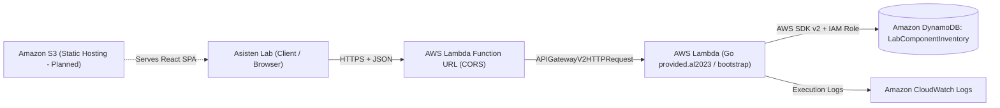

# LabComponentInventory — Serverless Laboratory Sparepart Management System

**Track:** Track C (Serverless Architecture)  
**User Persona:** Asisten Laboratorium Hardware / IoT  

Sistem manajemen inventaris komponen elektronika berbasis cloud *serverless* untuk memantau stok aktual (mikrokontroler, sensor, kabel, dan komponen pasif), lokasi laci penyimpanan, serta peringatan stok menipis (`stock_qty <= min_stock`) secara *real-time*.

---

## Arsitektur Sistem & Tech Stack



- **HTTPS Entrypoint:** **AWS Lambda Function URL** dengan konfigurasi CORS (`Access-Control-Allow-Origin: *`) yang meneruskan request HTTPS langsung ke fungsi AWS Lambda.
- **AWS Lambda (Go Runtime — `provided.al2023`):** Binary Linux (`bootstrap`) menggunakan Go dan AWS SDK for Go v2 dengan arsitektur *Separation of Concerns*.
- **Amazon DynamoDB:** Database NoSQL serverless dengan satu tabel tunggal `LabComponentInventory` menggunakan mode kapasitas **On-Demand** (`PAY_PER_REQUEST`).
- **IAM Execution Role:** Prinsip *least privilege* pada `template.yaml` (`PutItem`, `GetItem`, `Scan`, `UpdateItem`, `DeleteItem` + CloudWatch Logs), serta dukungan `ExistingRoleArn` (`LabRole`) untuk AWS Academy Sandbox.
- **Jaringan:** Menggunakan jaringan terkelola default AWS tanpa VPC kustom maupun NAT Gateway untuk *cold-start* rendah dan biaya operasional minimal.
- **Frontend Client (React SPA):** Vite + React + TypeScript untuk tabel inventaris, indikator stok menipis (`stock_qty <= min_stock`), serta form tambah, edit, dan hapus komponen *(dalam tahap pengembangan)*.

---

## Development Checklist

### 1. Repository & Documentation
- [x] Inisialisasi repositori Git & struktur folder *Separation of Concerns*
- [x] Progress tracker ([docs/progress_backend.md](docs/progress_backend.md) & [docs/progress_frontend.md](docs/progress_frontend.md))
- [x] Dokumentasi README, skema data, dan kontrak API
- [ ] Design Brief 1–2 halaman (`docs/design-brief.md`)
- [ ] Deployment Plan (`docs/deployment-plan.md`)

### 2. Backend Core (Go + AWS Lambda + DynamoDB)
- [x] Environment configuration loader (`internal/config/`)
- [x] Standardized domain & API errors (`internal/apperror/`)
- [x] Entity model `Component`, enums, & input validation (`internal/model/`) + unit tests
- [x] Repository interface, In-Memory seed store, & DynamoDB AWS SDK v2 (`internal/repository/`)
- [x] Business logic service & ISO 8601 timestamping (`internal/service/`) + unit tests
- [x] CORS, CloudWatch logging, & panic recovery middlewares (`internal/middleware/`)
- [x] CRUD handlers & JSON response helpers (`internal/handler/`)
- [x] API Gateway v2 route dispatcher (`internal/route/`) + unit tests
- [x] Entrypoints AWS Lambda `provided.al2023` (`cmd/lambda/`) & local demo server (`cmd/local/`)
- [x] Verifikasi `go test -v ./...` & cross-compile `GOOS=linux GOARCH=amd64` (`bootstrap`)

### 3. Infrastructure & AWS Connectivity
- [x] CloudFormation template (`infra/template.yaml`) untuk DynamoDB, IAM, Lambda, API Gateway / Function URL
- [x] Skrip build binary Lambda (`infra/build.ps1`)
- [x] Skrip deploy AWS CLI dengan dukungan `LabRole` Sandbox (`infra/deploy.ps1`)
- [x] Skrip uji konektivitas CRUD otomatis (`infra/verify.ps1`)
- [x] Verifikasi deploy & konektivitas CRUD live di AWS Sandbox (`us-east-1`) + CloudWatch Logs

### 4. Frontend Client (React + TypeScript SPA)
- [ ] Scaffold Vite + React + TypeScript (`vite.config.ts`, `tsconfig.json`, `index.html`)
- [ ] TypeScript contracts & API client (`src/types/`, `src/api/`)
- [ ] Pure helpers & custom hook `useInventory` (`src/utils/`, `src/hooks/`)
- [ ] Dashboard UI: `StatsBar`, `InventoryTable` (`stock_qty <= min_stock`), & modal CRUD (`src/components/`)
- [ ] Integrasi end-to-end dengan endpoint AWS & build produksi untuk S3 static hosting

---

## Spesifikasi Data Entity (`LabComponentInventory`)

- **Nama Tabel:** `LabComponentInventory`
- **Partition Key:** `item_id` (`String`, contoh: `CMP-001`)

| Nama Atribut | Tipe Data | Keterangan | Contoh Nilai |
| :--- | :--- | :--- | :--- |
| `item_id` | String (PK) | Kode unik komponen laboratorium | `"CMP-001"` |
| `name` | String | Nama komponen atau modul | `"STM32F401 Blackpill"` |
| `category` | String | `MICROCONTROLLER`, `SENSOR`, `CABLE`, `PASSIVE` | `"MICROCONTROLLER"` |
| `stock_qty` | Number | Jumlah stok fisik yang tersedia saat ini | `15` |
| `min_stock` | Number | Batas ambang minimum stok untuk peringatan restock | `5` |
| `drawer_location` | String | Kode rak atau laci penyimpanan | `"RAK-A2"` |
| `condition` | String | Status kondisi fisik (`NEW`, `GOOD`, `DEFECTIVE`) | `"GOOD"` |
| `updated_at` | String | Timestamp pembaruan terakhir (ISO 8601) | `"2026-11-25T23:20:00Z"` |

---

## Kontrak API Endpoints (RESTful CRUD)

Seluruh respons mengembalikan format JSON dengan header CORS (`Access-Control-Allow-Origin: *`).

| Method | Route | Fungsi | Status Sukses |
| :--- | :--- | :--- | :--- |
| `POST` | `/items` | Menambahkan komponen baru ke DynamoDB | `201 Created` |
| `GET` | `/items` | Mengambil seluruh daftar komponen | `200 OK` |
| `GET` | `/items/{id}` | Mengambil detail satu komponen berdasarkan `item_id` | `200 OK` / `404 Not Found` |
| `PUT` | `/items/{id}` | Memperbarui `stock_qty`, `drawer_location`, atau `condition` | `200 OK` |
| `DELETE` | `/items/{id}` | Menghapus data komponen dari inventaris | `200 OK` |

---

## Cara Menjalankan & Deployment

### Uji Lokal (Tanpa AWS)
```powershell
# 1. Jalankan unit test backend
cd backend
go test -v ./...

# 2. Jalankan local demo server (port 8080, in-memory store)
go run ./cmd/local

# 3. Uji seluruh endpoint CRUD lokal (terminal baru)
.\infra\verify.ps1 -ApiUrl "http://localhost:8080"
```

### Deploy & Uji Konektivitas di AWS
```powershell
# Mode AWS Academy Cloud Foundations Sandbox (menggunakan LabRole & Lambda Function URL)
.\infra\deploy.ps1 -UseLabRole -EndpointMode FunctionUrl

# Mode AWS Learner Lab / Akun AWS Penuh (menggunakan API Gateway HTTP API)
.\infra\deploy.ps1 -UseLabRole -EndpointMode ApiGateway

# Uji seluruh endpoint CRUD ke URL hasil output deploy
.\infra\verify.ps1 -ApiUrl "<ApiEndpoint-dari-output-deploy>"
```
