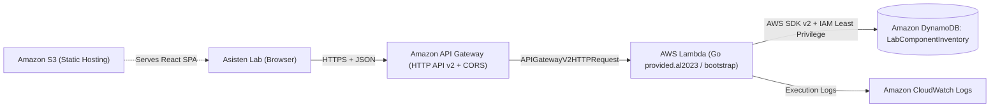

# LabComponentInventory — Serverless Laboratory Sparepart Management System

**Track:** Track C (Serverless Architecture)  
**User Persona:** Asisten Laboratorium Hardware / IoT  

Sistem manajemen inventaris komponen elektronika berbasis cloud *serverless* untuk memantau stok aktual (mikrokontroler, sensor, kabel, dan komponen pasif), lokasi laci penyimpanan, serta peringatan stok menipis (`stock_qty <= min_stock`) secara *real-time*.

---

## Arsitektur Sistem & Tech Stack



- **Frontend Client (React SPA):** Vite + React + TypeScript untuk menampilkan tabel inventaris, indikator stok menipis (`stock_qty <= min_stock`), serta form tambah, edit, dan hapus komponen. Dapat dijalankan lokal maupun di-host statis di Amazon S3.
- **Amazon API Gateway (HTTP API):** Endpoint publik HTTPS dengan konfigurasi CORS (`Access-Control-Allow-Origin: *`), meneruskan request ke AWS Lambda.
- **AWS Lambda (Go Runtime — `provided.al2023`):** Binary Linux (`bootstrap`) menggunakan Go dan AWS SDK for Go v2 dengan arsitektur *Separation of Concerns*.
- **Amazon DynamoDB:** Database NoSQL serverless dengan satu tabel `LabComponentInventory` menggunakan mode kapasitas **On-Demand** (`PAY_PER_REQUEST`).
- **IAM Execution Role:** Prinsip *least privilege*, hanya mengizinkan `dynamodb:PutItem`, `dynamodb:GetItem`, `dynamodb:Scan`, `dynamodb:UpdateItem`, `dynamodb:DeleteItem` pada tabel terkait serta pengiriman log ke CloudWatch.
- **Jaringan:** Menggunakan jaringan terkelola default AWS tanpa VPC kustom maupun NAT Gateway untuk *cold-start* rendah dan biaya operasional mendekati nol.

---

## Spesifikasi Data Entity (`LabComponentInventory`)

- **Nama Tabel:** `LabComponentInventory`
- **Partition Key:** `item_id` (`String`, contoh: `CMP-001`)

| Nama Atribut | Tipe Data | Keterangan | Contoh Nilai |
| :--- | :--- | :--- | :--- |
| `item_id` | String (PK) | Kode unik komponen laboratorium | `"CMP-001"` |
| `name` | String | Nama komponen atau modul | `"STM32F401 Blackpill"` |
| `category` | String | `MICROCONTROLLER`, `SENSOR`, `CABLE`, `PASSIVE` | `"MICROCONTROLLER"` |
| `stock_qty` | Number | Jumlah stok fisik yang tersedia saat ini | `15` |
| `min_stock` | Number | Batas ambang minimum stok untuk peringatan restock | `5` |
| `drawer_location` | String | Kode rak atau laci penyimpanan | `"RAK-A2"` |
| `condition` | String | Status kondisi fisik (`NEW`, `GOOD`, `DEFECTIVE`) | `"GOOD"` |
| `updated_at` | String | Timestamp pembaruan terakhir (ISO 8601) | `"2026-11-25T23:20:00Z"` |

---

## Kontrak API Endpoints (RESTful CRUD)

Seluruh respons mengembalikan format JSON dengan header CORS (`Access-Control-Allow-Origin: *`).

| Method | Route | Fungsi | Status Sukses |
| :--- | :--- | :--- | :--- |
| `POST` | `/items` | Menambahkan komponen baru ke DynamoDB | `201 Created` |
| `GET` | `/items` | Mengambil seluruh daftar komponen | `200 OK` |
| `GET` | `/items/{id}` | Mengambil detail satu komponen berdasarkan `item_id` | `200 OK` / `404 Not Found` |
| `PUT` | `/items/{id}` | Memperbarui `stock_qty`, `drawer_location`, atau `condition` | `200 OK` |
| `DELETE` | `/items/{id}` | Menghapus data komponen dari inventaris | `200 OK` |

---

## Struktur Proyek (Separation of Concerns)

```text
LabVentory/
├── backend/
│   ├── cmd/
│   │   ├── lambda/          # Entrypoint AWS Lambda (provided.al2023)
│   │   └── local/           # HTTP server lokal untuk demo tanpa AWS
│   └── internal/
│       ├── config/          # Environment variable loader
│       ├── apperror/        # Standardized domain & API errors
│       ├── model/           # Entity Component, enums & validasi input
│       ├── repository/      # Interface & implementasi DynamoDB / In-Memory
│       ├── service/         # Business logic & timestamping
│       ├── middleware/      # CORS, CloudWatch logging, panic recovery
│       ├── handler/         # CRUD controllers & JSON response helpers
│       └── route/           # API Gateway v2 route dispatcher
├── frontend/                # React + TypeScript SPA (Vite)
├── infra/                   # CloudFormation template & skrip deploy AWS CLI
└── docs/                    # Progress tracker, architecture, & design brief
```

---

## Menjalankan Secara Lokal & Deployment

- **Progress Implementasi:** Lihat [docs/progress_backend.md](docs/progress_backend.md) dan [docs/progress_frontend.md](docs/progress_frontend.md).
- **Backend Tests:** `cd backend && go test -v ./...`
- **Local Demo Server:** `cd backend && go run ./cmd/local`
- **Frontend Dev:** `cd frontend && npm run dev`
- **AWS Deploy:** Jalankan `infra/build.ps1` lalu `infra/deploy.ps1` menggunakan AWS CLI.
