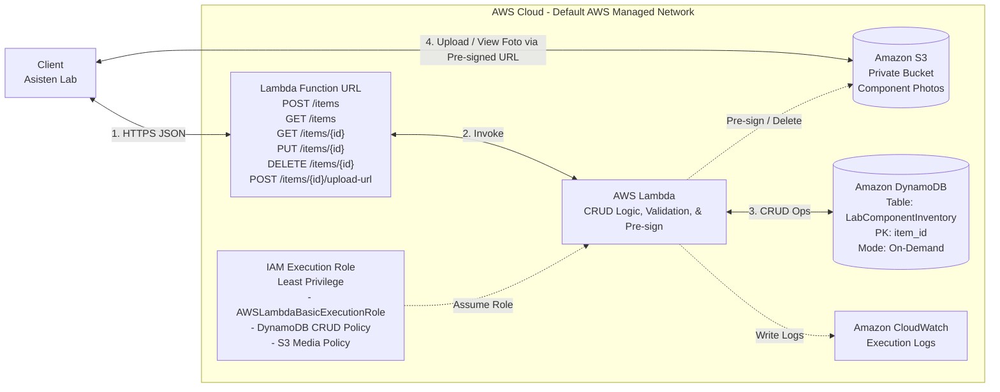

# LabComponentInventory — Serverless Laboratory Sparepart Management System

**Track:** Track C — Serverless Architecture  
**User Persona:** Asisten Laboratorium Hardware / IoT  

Sistem manajemen inventaris komponen elektronika berbasis cloud *serverless* untuk memantau stok aktual mikrokontroler, sensor, kabel, dan komponen pasif, lokasi laci penyimpanan, foto komponen, serta peringatan stok menipis `stock_qty <= min_stock` secara *real-time*.

---

## Arsitektur Sistem & Tech Stack



- **HTTPS Entrypoint:** **AWS Lambda Function URL** dengan konfigurasi CORS `Access-Control-Allow-Origin: *` yang meneruskan request HTTPS langsung ke fungsi AWS Lambda.
- **AWS Lambda — Go Runtime `provided.al2023`:** Binary Linux `bootstrap` menggunakan Go dan AWS SDK for Go v2 dengan arsitektur *Separation of Concerns*.
- **Amazon DynamoDB:** Database NoSQL serverless dengan satu tabel tunggal `LabComponentInventory` menggunakan mode kapasitas **On-Demand** `PAY_PER_REQUEST`.
- **Amazon S3:** Bucket privat terkonfigurasi CORS untuk menyimpan foto komponen elektronika, diakses aman menggunakan S3 Pre-signed URL dari AWS Lambda.
- **IAM Execution Role:** Prinsip *least privilege* pada `template.yaml` meliputi `PutItem`, `GetItem`, `Scan`, `UpdateItem`, `DeleteItem`, akses objek S3, serta CloudWatch Logs, dengan dukungan `ExistingRoleArn` berupa `LabRole` untuk AWS Academy Sandbox.
- **Jaringan:** Menggunakan jaringan terkelola default AWS tanpa VPC kustom maupun NAT Gateway untuk *cold-start* rendah dan biaya operasional minimal.
- **Frontend Client — React SPA:** Vite, React, dan TypeScript untuk tabel inventaris, indikator stok menipis `stock_qty <= min_stock`, serta form tambah, edit, dan hapus komponen — *dalam tahap pengembangan*.

---

## Development Checklist

### 1. Repository & Documentation
- [x] Inisialisasi repositori Git & struktur folder *Separation of Concerns*
- [x] Progress tracker: [docs/progress_backend.md](docs/progress_backend.md) & [docs/progress_frontend.md](docs/progress_frontend.md)
- [x] Dokumentasi README, skema data, dan kontrak API

### 2. Backend Core — Go, AWS Lambda, DynamoDB, & S3
- [x] Environment configuration loader di `internal/config/`
- [x] Standardized domain & API errors di `internal/apperror/`
- [x] Entity model `Component`, enums, `image_key`, `UploadURL` & input validation di `internal/model/` + unit tests
- [x] Repository interface, In-Memory seed store, & DynamoDB AWS SDK v2 di `internal/repository/`
- [x] MediaStorage interface & S3 Pre-signed URL adapter di `internal/storage/`
- [x] Business logic service, ISO 8601 timestamping, & pre-signed URL orchestration di `internal/service/` + unit tests
- [x] CORS, CloudWatch logging, & panic recovery middlewares di `internal/middleware/`
- [x] CRUD + upload-url handlers & JSON response helpers di `internal/handler/`
- [x] API Gateway v2 route dispatcher di `internal/route/` + unit tests
- [x] Entrypoints AWS Lambda `provided.al2023` di `cmd/lambda/` & local demo server di `cmd/local/`
- [x] Verifikasi `go test -v ./...` & cross-compile `GOOS=linux GOARCH=amd64` untuk `bootstrap`

### 3. Infrastructure & AWS Connectivity
- [x] CloudFormation template `infra/template.yaml` untuk DynamoDB, S3 bucket privat, IAM, Lambda, API Gateway / Function URL
- [x] Skrip build binary Lambda `infra/build.ps1`
- [x] Skrip deploy AWS CLI dengan dukungan `LabRole` Sandbox `infra/deploy.ps1`
- [x] Skrip uji konektivitas CRUD otomatis `infra/verify.ps1`
- [x] Verifikasi deploy & konektivitas CRUD + S3 Pre-signed URL live di AWS Sandbox `us-east-1` + CloudWatch Logs

### 4. Frontend Client — React + TypeScript SPA
- [ ] Scaffold Vite + React + TypeScript: `vite.config.ts`, `tsconfig.json`, `index.html`
- [ ] TypeScript contracts & API client di `src/types/` dan `src/api/`
- [ ] Pure helpers & custom hook `useInventory` di `src/utils/` dan `src/hooks/`
- [ ] Dashboard UI: `StatsBar`, `InventoryTable` dengan `stock_qty <= min_stock`, & modal CRUD di `src/components/`
- [ ] Integrasi end-to-end dengan endpoint AWS & build produksi untuk S3 static hosting

---

## Spesifikasi Data Entity — `LabComponentInventory`

- **Nama Tabel:** `LabComponentInventory`
- **Partition Key:** `item_id` — bertipe `String`, contoh `CMP-001`

| Nama Atribut | Tipe Data | Keterangan | Contoh Nilai |
| :--- | :--- | :--- | :--- |
| `item_id` | String — PK | Kode unik komponen laboratorium | `"CMP-001"` |
| `name` | String | Nama komponen atau modul | `"STM32F401 Blackpill"` |
| `category` | String | `MICROCONTROLLER`, `SENSOR`, `CABLE`, `PASSIVE` | `"MICROCONTROLLER"` |
| `stock_qty` | Number | Jumlah stok fisik yang tersedia saat ini | `15` |
| `min_stock` | Number | Batas ambang minimum stok untuk peringatan restock | `5` |
| `drawer_location` | String | Kode rak atau laci penyimpanan | `"RAK-A2"` |
| `condition` | String | Status kondisi fisik: `NEW`, `GOOD`, `DEFECTIVE` | `"GOOD"` |
| `image_key` | String | Object key foto komponen di Amazon S3 | `"items/CMP-001/stm32.png"` |
| `updated_at` | String | Timestamp pembaruan terakhir format ISO 8601 | `"2026-11-25T23:20:00Z"` |

---

## Kontrak API Endpoints — RESTful CRUD & Media

Seluruh respons mengembalikan format JSON dengan header CORS `Access-Control-Allow-Origin: *`.

| Method | Route | Fungsi | Status Sukses |
| :--- | :--- | :--- | :--- |
| `POST` | `/items` | Menambahkan komponen baru ke DynamoDB | `201 Created` |
| `GET` | `/items` | Mengambil seluruh daftar komponen | `200 OK` |
| `GET` | `/items/{id}` | Mengambil detail satu komponen beserta `image_url` | `200 OK` / `404 Not Found` |
| `PUT` | `/items/{id}` | Memperbarui `stock_qty`, `drawer_location`, `condition`, atau `image_key` | `200 OK` |
| `DELETE` | `/items/{id}` | Menghapus data komponen dan objek gambar terkait | `200 OK` |
| `POST` | `/items/{id}/upload-url` | Membuat S3 Pre-signed PUT URL untuk mengunggah foto komponen | `200 OK` |

---

## Cara Menjalankan & Deployment

### Uji Lokal — Tanpa AWS
```powershell
# 1. Jalankan unit test backend
cd backend
go test -v ./...

# 2. Jalankan local demo server di port 8080 dengan in-memory store
go run ./cmd/local

# 3. Uji seluruh endpoint CRUD lokal dari terminal baru
.\infra\verify.ps1 -ApiUrl "http://localhost:8080"
```

### Deploy & Uji Konektivitas di AWS
```powershell
# Mode AWS Academy Cloud Foundations Sandbox menggunakan LabRole & Lambda Function URL
.\infra\deploy.ps1 -UseLabRole -EndpointMode FunctionUrl

# Mode AWS Learner Lab / Akun AWS Penuh menggunakan API Gateway HTTP API
.\infra\deploy.ps1 -UseLabRole -EndpointMode ApiGateway

# Uji seluruh endpoint CRUD ke URL hasil output deploy
.\infra\verify.ps1 -ApiUrl "<ApiEndpoint-dari-output-deploy>"
```
